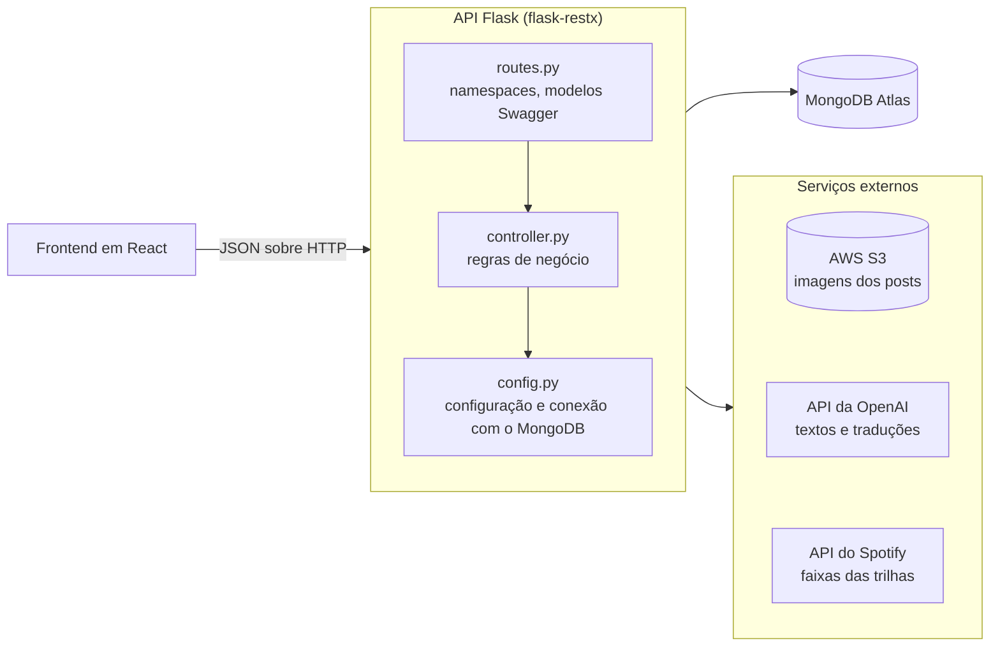

# Movie Search Blog — backend

[](https://github.com/francisdiasbr/movie-search-blog-backend/actions/workflows/ci.yml)

API REST do **blog do Movie Search**, um blog pessoal sobre cinema: resenhas autorais, posts, opiniões
pessoais, recomendações, diretores e trilhas sonoras de cada filme. Atende um frontend em React e
TypeScript, que fica em outro repositório
([movie-search-blog](https://github.com/francisdiasbr/movie-search-blog)).

Construída com **Python 3.11, Flask, flask-restx, MongoDB Atlas, AWS S3, API da OpenAI e API do
Spotify**.

> 🇺🇸 English version: [README_EN.md](README_EN.md)

## Índice

- [Arquitetura](#arquitetura)
- [API](#api)
- [Configuração](#configuração)
- [Rodando o projeto](#rodando-o-projeto)
- [Hospedagem](#hospedagem)
- [Testes](#testes)
- [Estrutura de pastas](#estrutura-de-pastas)

## Arquitetura



Cada feature é uma pasta com `routes.py` (namespace do flask-restx e rotas) e `controller.py` (regras
de negócio e acesso ao banco). O `app.py` registra um namespace por feature sob `/api`.

O que a API faz além de ler e gravar no MongoDB:

- **Imagens no S3:** lista as imagens de um filme e monta as URLs públicas.
- **Textos com a API da OpenAI:** biografia de diretores, descrição de trilhas sonoras e traduções
  entre português e inglês. O modelo é configurável por `OPENAI_MODEL`.
- **Trilhas no Spotify:** busca as faixas da trilha sonora de um filme.
- **Cache de detalhes:** junta filme, diretor e trilha num documento só, guardado por 24 horas, para a
  página de detalhe do blog abrir com uma requisição.
- **Pré-população:** gera diretor e trilha de um filme antes do primeiro acesso.

## API

A documentação interativa (Swagger UI) é servida em `/docs`. Todas as rotas ficam sob `/api`.

| Feature | Método e caminho | O que faz |
|---|---|---|
| Página inicial | `POST /home/cards` | Cards da página inicial do blog |
| Resenhas | `POST /write-review/search` | Busca resenhas, com filtros |
| | `GET /write-review/<tconst>` | Resenha de um filme |
| Posts | `POST /generate-blogpost/search` | Busca posts do blog |
| | `GET /generate-blogpost/<tconst>` | Post de um filme |
| Opiniões pessoais | `GET /personal-opinion` · `POST /personal-opinion` | Lista e busca opiniões, com filtros e paginação |
| | `GET` · `PUT /personal-opinion/<tconst>` | Lê e atualiza a opinião sobre um filme |
| Favoritos | `POST /favorites/search` | Busca filmes favoritados |
| Recomendações | `GET /recommendations/all` · `GET /recommendations/random` | Lista as recomendações |
| | `POST /recommendations/add` · `POST /recommendations/bulk-add` | Adiciona uma ou várias recomendações |
| | `DELETE /recommendations/<tconst>` · `DELETE /recommendations/clear` | Remove uma ou todas |
| Diretores | `GET /directors/all` | Diretores salvos |
| | `GET` · `DELETE /directors/<nome>` | Lê (gerando a biografia, se preciso) e remove um diretor |
| Trilhas sonoras | `GET /music/all` | Trilhas salvas |
| | `GET` · `DELETE /music/soundtrack` | Lê (gerando, se preciso) e remove a trilha de um filme |
| Imagens | `GET /images/<tconst>` | URLs das imagens de um filme |
| | `GET /images/<tconst>/<filename>` | URL pública de uma imagem |
| Detalhe do filme | `GET /movie-detail/<movie_id>` | Detalhes completos do filme, com cache |
| | `POST /movie-detail/<movie_id>/invalidate` · `POST /movie-detail/cleanup` | Invalida um cache e remove os expirados |
| | `GET /movie-detail/stats` | Estatísticas do cache |
| Pré-população | `POST /prepopulate/all` · `POST /prepopulate/movie` · `POST /prepopulate/<movie_id>` | Gera diretor e trilha de todos os filmes ou de um |
| | `GET /prepopulate/stats` | Estatísticas da pré-população |

`tconst` é o identificador de um título no IMDB, como `tt0053198`.

## Configuração

```bash
python -m venv venv
source venv/bin/activate   # no Windows: venv\Scripts\activate
pip install -r requirements.txt
cp .env.example .env
```

Variáveis do `.env`:

| Variável | Para quê |
|---|---|
| `MONGODB_CONNECTION_STRING`, `MONGODB_DATABASE` | Conexão com o MongoDB Atlas |
| `AWS_ACCESS_KEY_ID`, `AWS_SECRET_ACCESS_KEY`, `BUCKET_NAME` | Imagens no S3 |
| `OPENAI_API_KEY` | Biografias, descrições de trilha e traduções |
| `OPENAI_MODEL` | Opcional. Modelo da OpenAI; o padrão é `gpt-5.6-terra` |
| `SPOTIFY_CLIENT_ID`, `SPOTIFY_CLIENT_SECRET` | Faixas das trilhas sonoras |

## Rodando o projeto

```bash
python app.py   # http://localhost:5001, Swagger em /docs
```

## Hospedagem

Hoje a API **não está publicada**: os endereços antigos no Render e no Heroku estão fora do ar. O
`Procfile` (`gunicorn app:app`) deixa o projeto pronto para plataformas que seguem esse padrão.

## Testes

```bash
pip install -r requirements-dev.txt   # pytest, mongomock e Black
python -m pytest
python -m black --check .
```

A suíte roda offline em menos de um segundo. O MongoDB é simulado em memória com mongomock, as
credenciais são trocadas por valores falsos, e qualquer chamada real à OpenAI, ao Spotify, ao S3 ou à
rede derruba o teste. Cobre todos os controllers e, pelo cliente de teste do Flask, as rotas.

O GitHub Actions roda a formatação e a suíte a cada push e pull request
([`ci.yml`](.github/workflows/ci.yml)).

## Estrutura de pastas

```
app.py                app Flask, configuração do Swagger e registro das features
config.py             variáveis de ambiente e conexão com o MongoDB
home/                 cards da página inicial
write_review/         resenhas autorais
generate_blogpost/    posts do blog
personal_opinion/     opiniões pessoais
favorites/            filmes favoritados
recommendations/      recomendações de filmes
directors/            diretores e biografias
music/                trilhas sonoras
images/               imagens no S3
movie_detail_cache/   cache dos detalhes do filme
movie_prepopulate/    pré-população de diretor e trilha
process_all_movies.py script avulso para pré-popular todos os filmes
tests/                um arquivo de teste por controller
```
