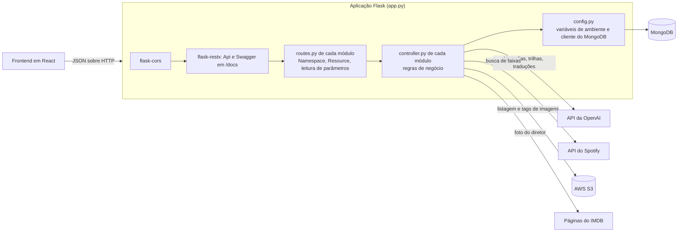
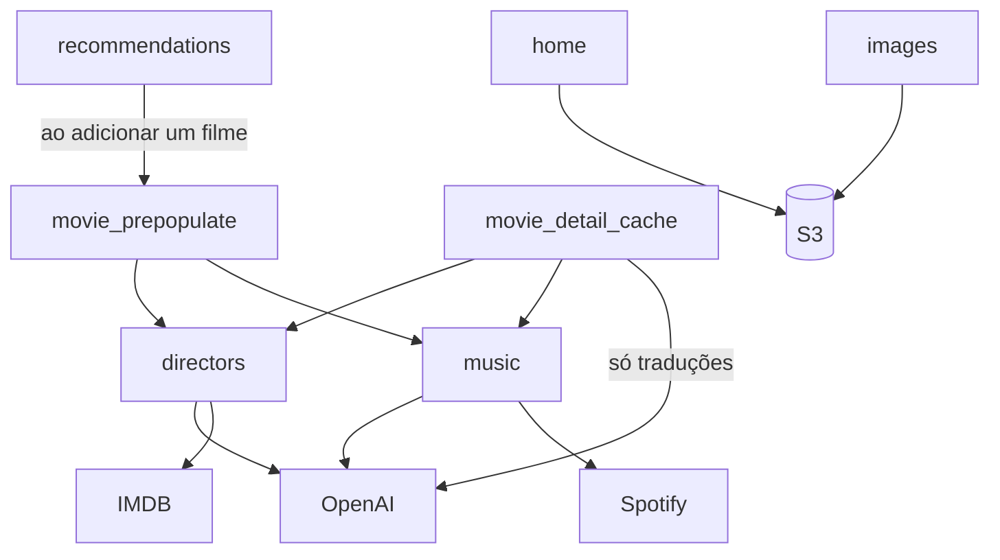
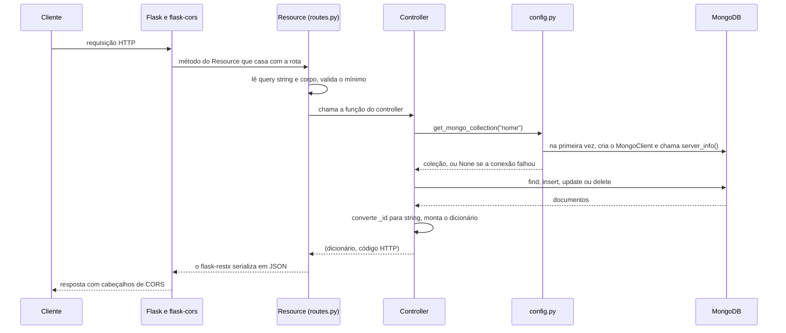
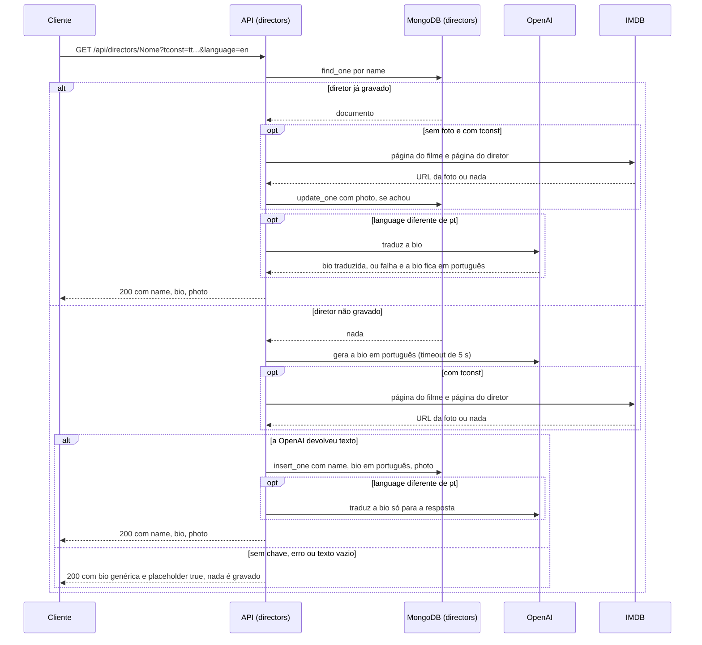
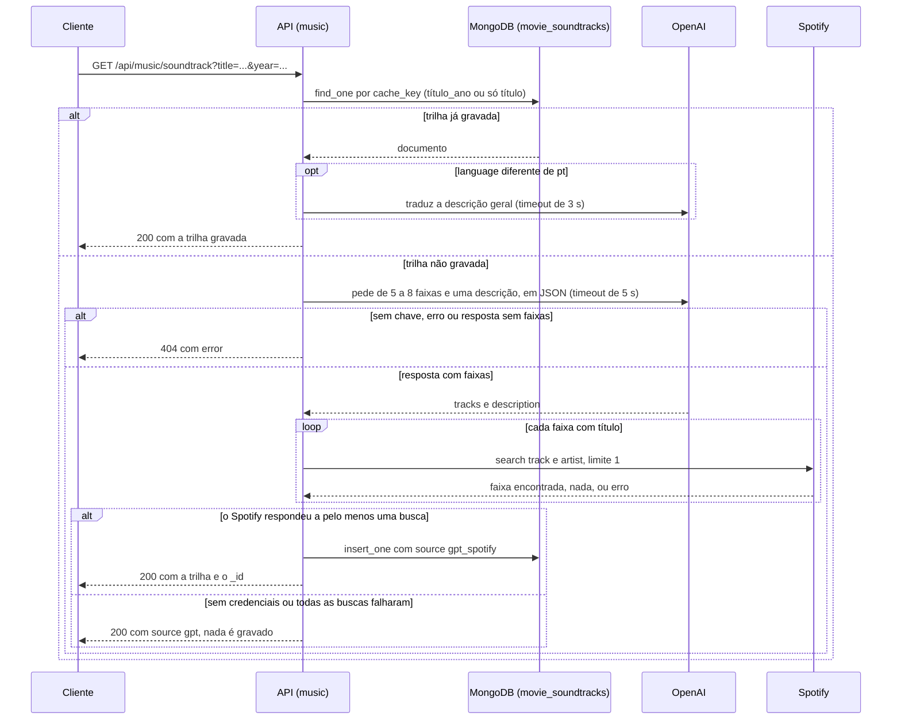
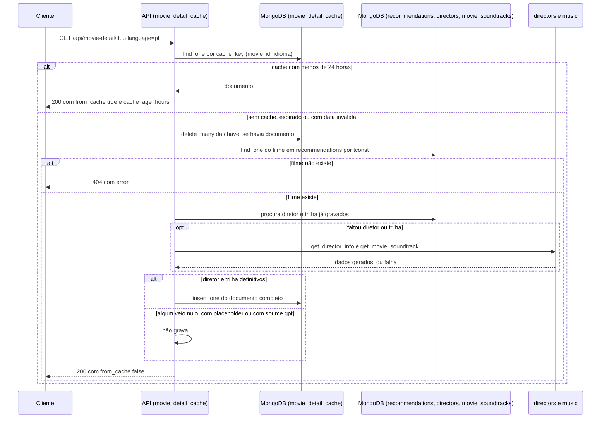

# Arquitetura

Este documento explica como a API é montada, o que acontece entre a chegada de uma requisição e a
resposta, como a configuração é lida e como os erros são devolvidos.

## Visão geral

A API é uma aplicação Flask com flask-restx. Ela lê e grava no MongoDB e chama quatro serviços
externos: a API da OpenAI, a API do Spotify, o AWS S3 e páginas públicas do IMDB.

A API não está publicada no momento. O `Procfile` contém `web: gunicorn app:app`, que é o comando
esperado por plataformas no estilo Heroku.

## Camadas

O código tem três camadas, e cada módulo de feature repete a mesma divisão.

| Camada | Onde fica | Responsabilidade |
|---|---|---|
| Aplicação | `app.py` | Cria o app Flask, configura CORS, cria o `Api` do flask-restx e registra os namespaces. |
| Rotas | `<módulo>/routes.py` | Declara o `Namespace`, as classes `Resource` e os modelos do Swagger. Lê a query string e o corpo, valida o mínimo e chama o controller. |
| Controller | `<módulo>/controller.py` | Regras de negócio, acesso ao MongoDB e chamadas externas. Devolve sempre um par `(dicionário, código HTTP)` ou, na pré-população, só o dicionário. |
| Configuração | `config.py` | Lê as variáveis de ambiente e entrega coleções do MongoDB. |

Não existe camada de modelo ou de repositório. Os controllers usam o `pymongo` diretamente e os
documentos trafegam como dicionários. Os arquivos `models.py` de `favorites` e `generate_blogpost`
contêm apenas modelos do Swagger (campos do flask-restx), não classes de domínio.

Dois módulos dependem de outros controllers:

Os módulos `favorites`, `generate_blogpost`, `write_review` e `personal_opinion` só falam com o
MongoDB.

## Inicialização do app

O `app.py` é executado de cima para baixo na importação. A ordem importa em um ponto.

1. Os onze `routes.py` são importados. Cada um importa o seu controller, e os controllers importam
   `config`. Na primeira importação de `config`, o `load_dotenv()` lê o arquivo `.env` e as variáveis
   são copiadas para constantes do módulo. Nenhuma conexão com o MongoDB é aberta nesse momento.
2. O app Flask é criado e o `CORS` é aplicado a todas as rotas (`/*`).
3. A rota `/` é registrada **antes** de `Api(app)`. O flask-restx também registra uma regra para `/`,
   e o Flask atende a primeira regra que casa. Registrada depois, a rota de status seria encoberta.
4. O `Api` é criado com título `Movie Search Blog API`, versão `1.0` e Swagger UI em `/docs`. A
   especificação fica em `/swagger.json`.
5. O nível de log do `pymongo` é reduzido para `WARNING`.
6. Cada namespace é registrado com `api.add_namespace(<módulo>_bp.api, path="/api/<prefixo>")`.
7. Cada `Blueprint` é registrado com o mesmo prefixo.

Sobre os passos 6 e 7: em todos os módulos, as rotas são declaradas no `Namespace` (`@api.route`), e
o `Blueprint` do módulo não tem nenhuma rota própria. Ele serve de suporte para o atributo `.api`,
que o `app.py` usa para achar o namespace. Quem de fato expõe as rotas é o `add_namespace`.

Rodando com `python app.py`, o servidor de desenvolvimento do Flask sobe com `debug=True` e
`threaded=True`. A porta vem de `PORT` (padrão `5001`) e o host de `FLASK_HOST` (padrão `0.0.0.0`).
Com gunicorn, esse bloco não é executado.

### CORS

| Opção | Valor |
|---|---|
| Origens | `*` |
| Métodos | `GET`, `POST`, `PUT`, `DELETE`, `OPTIONS`, `HEAD` |
| Cabeçalhos aceitos | `Content-Type`, `Authorization`, `X-Requested-With`, `Access-Control-Allow-Origin` |
| Cabeçalhos expostos | `Content-Type`, `X-Total-Count` |
| Credenciais | `supports_credentials=True` |
| `max_age` | 3600 segundos |

Na prática, a resposta devolve em `Access-Control-Allow-Origin` a origem que veio na requisição,
junto com `Access-Control-Allow-Credentials: true`. Nenhuma rota define o cabeçalho `X-Total-Count`,
apesar de ele estar na lista de expostos.

A API não tem autenticação nem autorização. Isso inclui as rotas que gravam e apagam dados.

## Ciclo de uma requisição

Pontos que valem para todas as rotas:

- **O controller devolve um dicionário e um código.** O flask-restx serializa esse dicionário com o
  `json` padrão. Nenhuma rota usa `marshal_with`, então os modelos do Swagger são apenas
  documentação: eles não filtram nem validam a resposta.
- **`_id` vira string no controller.** `ObjectId` não é serializável em JSON; cada controller converte
  manualmente, ou exclui o campo com a projeção `{"_id": 0}`.
- **Datas precisam de tratamento explícito.** Só dois módulos tratam `datetime`: o `home` (`_as_text`)
  e o `movie_detail_cache` (`_json_safe`). Nos demais, um documento com campo de data do BSON faz a
  serialização falhar e a resposta vira `500`. Veja [pontos-de-atencao.md](pontos-de-atencao.md).
- **A validação de entrada é feita à mão em cada rota**, sem `api.expect(..., validate=True)`. O que
  cada rota valida está descrito no documento do módulo.

## Configuração e variáveis de ambiente

`config.py` chama `load_dotenv()` e lê as variáveis uma única vez, na importação. O `load_dotenv` não
sobrescreve variáveis que já existem no ambiente.

| Variável | Obrigatória | Padrão | Usada em | Para quê |
|---|---|---|---|---|
| `MONGODB_CONNECTION_STRING` | Sim | nenhum | `config.py` | String de conexão do MongoDB. |
| `MONGODB_DATABASE` | Sim | nenhum | `config.py` | Nome do banco. |
| `AWS_ACCESS_KEY_ID` | Para imagens | nenhum | `images`, `home` | Credencial do cliente S3. |
| `AWS_SECRET_ACCESS_KEY` | Para imagens | nenhum | `images`, `home` | Credencial do cliente S3. |
| `BUCKET_NAME` | Para imagens | nenhum | `images/routes.py`, `home/controller.py` | Bucket das imagens. |
| `OPENAI_API_KEY` | Para gerar textos | nenhum | `directors`, `music`, `movie_detail_cache` | Chave da OpenAI. Sem ela, nenhum texto é gerado nem traduzido. |
| `OPENAI_MODEL` | Não | `gpt-5.6-terra` | os mesmos três módulos | Modelo usado em todas as chamadas de chat. |
| `SPOTIFY_CLIENT_ID` | Para dados do Spotify | nenhum | `music` | Credencial do fluxo client credentials. |
| `SPOTIFY_CLIENT_SECRET` | Para dados do Spotify | nenhum | `music` | Credencial do fluxo client credentials. |
| `PORT` | Não | `5001` | `app.py` (só com `python app.py`) | Porta do servidor de desenvolvimento. |
| `FLASK_HOST` | Não | `0.0.0.0` | `app.py` (só com `python app.py`) | Host do servidor de desenvolvimento. |

`PORT` e `FLASK_HOST` não aparecem no `.env.example`.

Um comentário em `config.py` registra o motivo do modelo padrão: o `gpt-3.5-turbo` foi desligado pela
OpenAI em 23/10/2026 e o `gpt-5.6-terra` é o substituto indicado. A troca **não foi validada com
chamada real**. Os parâmetros das chamadas (`max_tokens`, `temperature`) são os mesmos de antes; se
o modelo novo aceita esses parâmetros é **não verificado**. Veja [integracoes.md](integracoes.md).

Os módulos importam as constantes com `from config import ...`. Isso cria uma cópia do valor em cada
módulo no momento da importação. Mudar a variável de ambiente depois não tem efeito sem reiniciar o
processo.

A região do S3 (`us-east-2`) está fixa no código, em `images/controller.py` e `home/controller.py`.

### Conexão com o MongoDB

`config.get_mongo_client()` mantém um cliente único por processo, criado na primeira vez em que uma
rota precisa do banco:

1. Se já existe um cliente guardado em `_mongo_client`, ele é devolvido.
2. Senão, cria um `MongoClient` e chama `server_info()` para confirmar que o servidor responde.
3. Se deu certo, guarda o cliente e imprime uma mensagem no console.
4. Se falhou, imprime o erro e devolve `None`. Nada é guardado, então a próxima requisição tenta
   conectar de novo.

`config.get_mongo_collection(nome)` devolve `client[MONGODB_DATABASE][nome]` ou `None`.

Nenhum tempo limite de conexão é configurado no código; valem os padrões do `pymongo` (não verificado
quais são na versão instalada). O código também não cria índices em nenhuma coleção.

## Convenção de erros

Os controllers capturam exceções com `try/except` amplo e devolvem um dicionário com o código HTTP.
Não há um manipulador global de erros nem um formato único. Existem quatro formatos em uso:

| Formato | Exemplo | Módulos |
|---|---|---|
| `status` numérico e `message` | `{"status": 404, "message": "Opinião não encontrada"}` | `favorites`, `home`, `images`, `personal_opinion`, `write_review`, busca de `generate_blogpost`, listagens de `recommendations` |
| `error` | `{"error": "Erro ao buscar informações do diretor"}` | `directors`, `music`, `movie_detail_cache`, `recommendations` (adição), `movie_prepopulate` (estatísticas e validação) |
| `status` em texto e `mensagem` | `{"status": "erro", "mensagem": "Post não encontrado"}` | `GET /api/generate-blogpost/<tconst>` |
| `data` com texto | `{"data": "Recommendation tt1 not found"}` | remoção em `recommendations` |

A pré-população tem um quinto formato, em que o resultado é sempre um objeto com `status` em texto
(`success`, `already_exists`, `error`, `not_found`, `completed`), e a rota traduz esse `status` em
código HTTP.

O `favorites` é o único que acrescenta o texto da exceção em um campo `error`. A adição de
recomendações, a busca de posts e a pré-população também incluem o texto da exceção na mensagem. Os
demais devolvem mensagens fixas.

### Banco indisponível

Quando `get_mongo_collection` devolve `None`, o resultado é `500` em todas as rotas que usam o banco.
Três controllers checam `None` de forma explícita (`favorites`, `home`, `directors.get_director_info`).
Nos outros, o uso de `None` como coleção lança `AttributeError` dentro do `try`, e o `except` genérico
devolve o `500` do módulo. A pré-população devolve `status: "error"`, que a rota converte em `500`.

### Erros que não passam pelos controllers

| Situação | Resposta |
|---|---|
| Rota inexistente | `404` em HTML, a página padrão do Flask. |
| Método não permitido | `405` com `{"message": "The method is not allowed for the requested URL."}`. |
| Corpo sem `Content-Type: application/json` em rota que usa `request.get_json()` sem `silent=True` | `415` com mensagem do Flask em inglês. |
| Exceção não capturada dentro da rota (por exemplo, corpo JSON que é uma lista onde o código espera objeto) | `500` com `{"message": "Internal Server Error"}`. |
| Resposta com valor não serializável (por exemplo, `datetime`) | `500` com `{"message": "Internal Server Error"}`. |

As rotas que usam `get_json(silent=True)` e aceitam corpo ausente são: `POST /api/favorites/search`
(responde `400` para corpo que não é objeto), `POST /api/home/cards`,
`POST /api/movie-detail/<movie_id>/invalidate` e `POST /api/prepopulate/<movie_id>`.

## Fluxos principais

### Biografia de um diretor

`GET /api/directors/<nome>?tconst=<tconst>&language=<pt|en>`, para um nome sem vírgula. O caso de
vários diretores está em [funcionalidades/directors.md](funcionalidades/directors.md).

### Trilha sonora com OpenAI e Spotify

`GET /api/music/soundtrack?title=<título>&year=<ano>&director=<diretor>&language=<pt|en>`.

### Detalhe do filme com cache

`GET /api/movie-detail/<movie_id>?language=<idioma>`.

