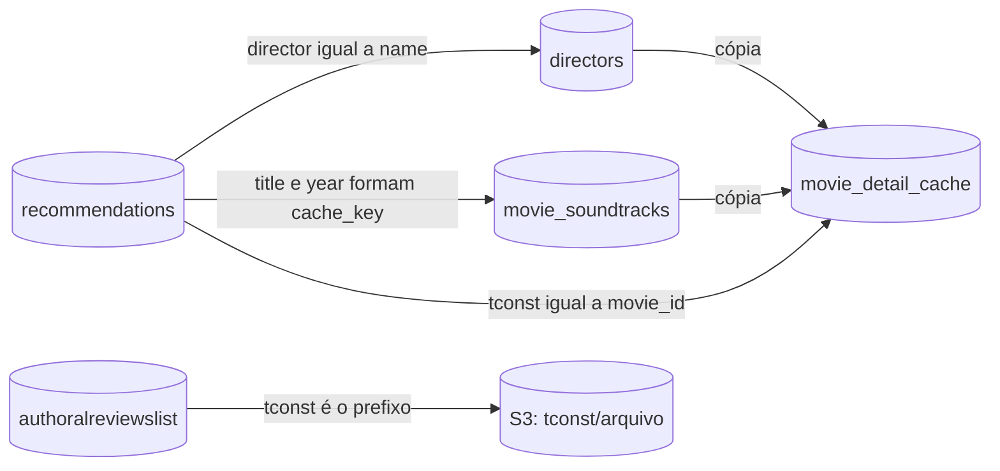

# Modelo de dados

A API usa um banco MongoDB (o nome vem de `MONGODB_DATABASE`) e um bucket S3 (`BUCKET_NAME`). Não há
esquema declarado em código: os documentos são dicionários, e os campos abaixo foram levantados a
partir do que os controllers leem, gravam e filtram, dos modelos do Swagger e dos dados usados nos
testes.

Como ler as tabelas:

- **Origem** diz quem preenche o campo. "Fora deste repositório" significa que nenhuma linha de
  código daqui grava o campo; a API apenas lê. Quem grava é não verificado.
- **Evidência** diz de onde saiu a informação sobre o campo: do código que o usa, do Swagger (que é
  só documentação) ou de um teste.

O conteúdo real do banco não foi consultado. Campos que só aparecem no Swagger podem não existir nos
documentos reais.

## Visão geral

| Coleção | Módulos que leem | Módulos que gravam | Chave de busca |
|---|---|---|---|
| `authoralreviewslist` | `write_review`, `home` | nenhum | `tconst` |
| `blogposts` | `generate_blogpost` | nenhum | `tconst` |
| `personal_opinions` | `personal_opinion` | `personal_opinion` (só atualização) | `tconst` |
| `favoritelist` | `favorites` | nenhum | não há leitura por chave |
| `recommendations` | `recommendations`, `movie_detail_cache`, `movie_prepopulate` | `recommendations` | `tconst` |
| `directors` | `directors`, `movie_detail_cache`, `movie_prepopulate` | `directors` | `name` |
| `movie_soundtracks` | `music`, `movie_detail_cache`, `movie_prepopulate` | `music` | `cache_key` |
| `movie_detail_cache` | `movie_detail_cache` | `movie_detail_cache` | `cache_key` |

As ligações entre coleções são por valor de texto, sem referência por `_id`. O código não cria
índices nem restrições de unicidade. Se existem índices criados direto no banco é não verificado.

Todos os documentos têm o `_id` gerado pelo MongoDB, devolvido pela API como string (ou omitido, nas
listagens `/directors/all` e `/music/all`).

## `authoralreviewslist`

Resenhas autorais. Lida por `write_review` (documento inteiro) e por `home` (só três campos).

| Campo | Tipo | Origem | Evidência |
|---|---|---|---|
| `tconst` | string | Fora deste repositório | Código: chave de busca, filtro de texto, prefixo das imagens no S3. |
| `primaryTitle` | string | Fora deste repositório | Código: filtro de texto e título do card. |
| `content` | objeto `{"pt": {"text": ...}, "en": {"text": ...}}`, ou string | Fora deste repositório | Código: o filtro `content` procura em `content.pt.text`, `content.en.text` e `content`. |
| `created_at` | data ou string | Fora deste repositório | Código: `home` converte data em texto ISO. |
| `isAiGenerated` | booleano | Fora deste repositório | Só Swagger. |
| `references` | lista de strings | Fora deste repositório | Só Swagger. |
| `images` | lista de strings | Fora deste repositório | Só Swagger. |

## `blogposts`

Posts do blog. Lida por `generate_blogpost`.

| Campo | Tipo | Origem | Evidência |
|---|---|---|---|
| `tconst` | string | Fora deste repositório | Código: chave de busca e filtro de texto. |
| `primaryTitle` | string | Fora deste repositório | Código: filtro de texto. |
| `title`, `introduction`, `historical_context`, `cultural_importance`, `technical_analysis`, `conclusion` | string | Fora deste repositório | Código: lista de campos de texto da busca. |
| `content`, `created_at`, `images`, `poster_url`, `references`, `soundtrack` | variados | Fora deste repositório | Só Swagger (modelo `BlogPost`). |

A lista de campos de texto da busca e o modelo do Swagger descrevem formas diferentes de documento.
Qual delas corresponde aos dados reais é não verificado.

## `personal_opinions`

Opiniões pessoais. Lida e atualizada por `personal_opinion`.

| Campo | Tipo | Origem | Evidência |
|---|---|---|---|
| `tconst` | string | Fora deste repositório (a API não cria opiniões) | Código: chave de busca. |
| `opinion` | string | Criação fora deste repositório; atualizado por `PUT /api/personal-opinion/<tconst>` | Código: campo gravável e filtro de texto. |
| `enjoying_1` | string | Idem | Código. |
| `enjoying_2` | string | Idem | Código. |

## `favoritelist`

Filmes favoritados. Lida por `favorites`.

| Campo | Tipo | Origem | Evidência |
|---|---|---|---|
| `tconst` | string | Fora deste repositório | Código: `search_term`. |
| `primaryTitle` | string | Fora deste repositório | Código: `search_term`. |
| `director` | string | Fora deste repositório | Código: `search_term`. |
| `country` | string | Fora deste repositório | Código: `distinct` para a lista de países. |
| `startYear` | número ou string numérica | Fora deste repositório | Código: convertido para inteiro na resposta; `distinct` para a lista de anos. |
| `soundtrack`, `wiki` | string | Fora deste repositório | Só Swagger (modelo `FavoriteMovie`). |

## `recommendations`

Lista de recomendações. É a única coleção de conteúdo criada por esta API.

| Campo | Tipo | Origem | Evidência |
|---|---|---|---|
| `tconst` | string | Corpo de `POST /recommendations/add` ou `/bulk-add`. Obrigatório. | Código: validação, chave de busca, duplicidade. |
| `position` | número | Corpo da requisição ou, se ausente, calculado: maior posição numérica mais 1. | Código: ordenação de `/random` e `/all`. |
| `title` | string | Corpo da requisição. | Código: busca em `/all`, chave da trilha, prompt da trilha. |
| `year` | string ou número | Corpo da requisição. | Código: chave da trilha. O Swagger descreve como string. |
| `director` | string, com vírgulas para vários nomes | Corpo da requisição. | Código: busca em `/all`, consulta de diretor. |
| `original_title`, `genres`, `imdb_rating`, `runtime`, `url` | string | Corpo da requisição. | Só Swagger (modelo `Recommendation`). |
| qualquer outra chave | | Corpo da requisição. | O código grava o objeto como veio. |

De onde vêm os dados enviados no corpo (por exemplo, uma exportação de watchlist do IMDB) é não
verificado; o Swagger descreve `position` como "posição na watchlist" e `url` como "URL do IMDb".

## `directors`

Um documento por diretor.

| Campo | Tipo | Origem |
|---|---|---|
| `name` | string | O nome que veio na requisição (caminho de `/api/directors/<nome>`, ou o campo `director` de uma recomendação, separado por vírgula). É a chave de busca, com igualdade exata. |
| `bio` | string | Texto gerado pela OpenAI, sempre em português. |
| `photo` | string ou nulo | URL de imagem extraída da página do diretor no IMDB (domínio `m.media-amazon.com`). Nulo quando não havia `tconst` ou a busca falhou. Pode ser preenchido depois, em uma consulta com `tconst`. |

Regras de gravação:

- O documento é criado por `get_director_info` só quando a OpenAI devolve uma biografia.
- A biografia genérica e a tradução para inglês nunca são gravadas.
- A resposta combinada de vários diretores não é gravada.
- O único campo atualizado depois da criação é `photo`.
- O documento é apagado por `DELETE /api/directors/<nome>`.

## `movie_soundtracks`

Um documento por combinação de título e ano.

| Campo | Tipo | Origem |
|---|---|---|
| `cache_key` | string | Calculado: `<título>_<ano>` quando há ano, ou só `<título>`. Chave de busca. |
| `movie_title` | string | Parâmetro `title` da requisição, ou `title` da recomendação. |
| `movie_year` | inteiro, string ou nulo | Parâmetro `year` (inteiro) ou `year` da recomendação (como estiver gravado). |
| `movie_director` | string ou nulo | Parâmetro `director`, ou `director` da recomendação. |
| `description` | string | Descrição geral da trilha, da OpenAI. No idioma da requisição que gerou o documento. |
| `source` | string | Sempre `gpt_spotify` nos documentos gravados por este código. |
| `tracks` | lista | Veja abaixo. |

Cada item de `tracks`:

| Campo | Tipo | Origem quando o Spotify achou a faixa | Origem quando não achou |
|---|---|---|---|
| `title` | string | Spotify (`name`) | OpenAI |
| `artist` | string | Spotify (nome do primeiro artista) | OpenAI, ou string vazia |
| `spotify_id` | string ou nulo | Spotify (`id`) | nulo |
| `preview_url` | string ou nulo | Spotify (`preview_url`, que pode vir nulo) | nulo |
| `external_urls` | objeto | Spotify (`external_urls`) | `{}` |
| `album` | objeto ou nulo | `{"name": ..., "images": [...]}`, do Spotify | nulo |
| `duration_ms` | inteiro ou nulo | Spotify | nulo |
| `description` | string | OpenAI | OpenAI, ou string vazia |

Regras de gravação:

- O documento é criado por `get_movie_soundtrack` só quando `source` é `gpt_spotify`.
- Depois de criado, o documento não é atualizado. Para refazer uma trilha, é preciso apagá-la com
  `DELETE /api/music/soundtrack`.

## `movie_detail_cache`

Um documento por filme e idioma, com validade de 24 horas.

| Campo | Tipo | Origem |
|---|---|---|
| `cache_key` | string | Calculado: `<movie_id>_<language>`. Chave de busca. |
| `movie_id` | string | O `tconst` do caminho da rota. |
| `language` | string | O parâmetro `language`, como veio. |
| `movie` | objeto | Cópia do documento de `recommendations`, com `_id` em string. |
| `director` | objeto ou nulo | Cópia do documento de `directors` (com a biografia traduzida, se o idioma não é `pt`), ou a resposta combinada de vários diretores. Nulo só quando o filme não tem diretor. |
| `soundtrack` | objeto | Cópia do documento de `movie_soundtracks`, com a descrição traduzida se o idioma não é `pt`. |
| `created_at` | data | Momento da montagem, com precisão de milissegundos. É o campo que define a validade. |
| `from_cache` | booleano | Gravado como `false`. Na leitura, a resposta troca para `true`. |

`cache_age_hours` aparece na resposta, mas não é gravado.

Regras de gravação:

- O documento só é gravado quando diretor e trilha são definitivos. Veja
  [funcionalidades/movie-detail-cache.md](funcionalidades/movie-detail-cache.md).
- É apagado na leitura, quando expirou; por `POST /api/movie-detail/<movie_id>/invalidate`; e por
  `POST /api/movie-detail/cleanup`.
- O código não cria índice TTL.

## O que fica no S3

O S3 guarda as imagens dos filmes. Nada mais do projeto usa a AWS.

| Item | Valor |
|---|---|
| Bucket | `BUCKET_NAME` |
| Região | `us-east-2`, fixa no código |
| Chave do objeto | `<tconst>/<nome do arquivo>` |
| Tag `subtitle_pt` | Legenda da imagem em português |
| Tag `subtitle_en` | Legenda da imagem em inglês |
| Metadado usado | `LastModified`, para ordenar a listagem de `images` |

A API só executa duas operações: `list_objects_v2` e `get_object_tagging`. Ela não envia, não altera
e não apaga objetos. O processo que envia as imagens e grava as tags é não verificado.

As URLs devolvidas têm o formato `https://<bucket>.s3.us-east-2.amazonaws.com/<chave>` e não são
assinadas. O MongoDB não guarda essas URLs: elas são montadas a cada requisição, a partir da listagem
do bucket.
